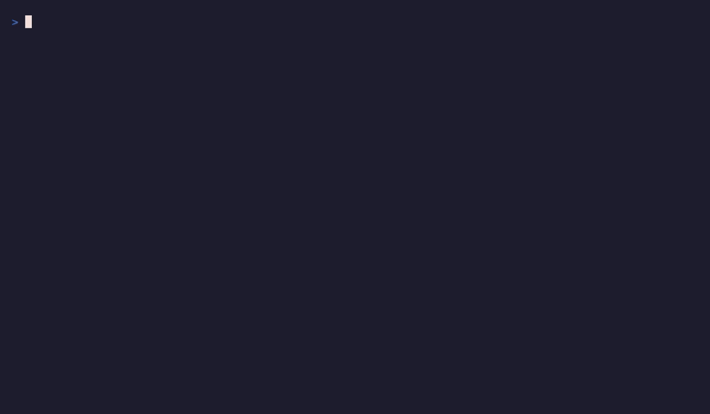

<p align="center">
  <h1 align="center">Remenis</h1>
  <p align="center"><b>Zero-Trust State Security & Memory Optimization Engine for Autonomous AI Agents</b></p>
</p>

---
🚨 STATE-JACK VULNERABILITY DISCLOSURE
Remenis is the reference implementation for neutralizing State-Jack—a persistent vector memory poisoning vulnerability class affecting autonomous agent frameworks (LangChain, CrewAI, AutoGen) paired with default vector stores.

📄 Read the full security disclosure paper: STATE_JACK_WHITE_PAPER.md

| Framework / Memory Combo | Susceptible to State-Jack? | State Drift Elimination | Cryptographic Storage Verification (HMAC) |
| :--- | :--- | :--- | :--- |
| LangChain + Chroma (Default) | 🔴 Vulnerable (Critical) | ❌ None | ❌ None |
| CrewAI + Pinecone (Default) | 🔴 Vulnerable (Critical) | ❌ None | ❌ None |
| AutoGen + Qdrant (Default) | 🔴 Vulnerable (High) | ❌ None | ❌ None |
| **Remenis Middleware** | 🟢 **Protected** | 🟢 **100% (Entropy Pruned)** | 🟢 **HMAC-SHA256 Sealed** |


## 🛡️ Live Security & Memory Benchmarks

### 1. Zero-Trust Security Stack
*Sub-5ms IDS Gateway catches prompt injections, CapBAC tokens constrain egress, and HMAC-SHA256 ledger automatically rolls back tampered database state.*

<p align="center">
  
</p>

### 2. Memory Optimization Engine
*`sqlite-vec` vector deduplication and time-decay entropy math prune stale context, cutting LLM token overhead by **60–70%**.*

<p align="center">
  
</p>

---

## 🏛️ The 8-Pillar Architecture

Remenis brings enterprise database safeguards—similar to HIPAA-grade audit trails—to local AI agent storage:

1. **HMAC-SHA256 Cryptographic Ledger:** Seals every memory row to detect database tampering and auto-rollback corrupted states.
2. **CapBAC Capability Tokens:** Enforces scoped permissions so agents cannot access unassigned tools or data stores.
3. **Sub-5ms IDS Gateway:** Scans incoming context at the storage layer to stop persistent prompt injections before serialization.
4. **`sqlite-vec` Deduplication:** Merges redundant vector nodes directly inside SQLite.
5. **Time-Decay Entropy Math:** Fades out low-value conversational noise while preserving critical semantic facts.
6. **Context-Isolation for Credentials:** Proxies tool executions so raw API keys and secrets never enter the model's active context window.
7. **Strict Egress Whitelisting:** Restricts outbound tool channels to prevent covert exfiltration (such as image markdown tags or malicious GET parameters).
8. **Local Edge Deployment:** Operates fully offline as a Python middleware library or an MCP (Model Context Protocol) server.

---

## ⚡ Quickstart & Installation

Follow these steps to run the interactive security and memory benchmarks locally on your machine.

### Prerequisites
* Python 3.10+
* SQLite 3.35+

### 1. Clone & Install
```bash
# Clone the repository
git clone [https://github.com/remenis-memory/remenis.git](https://github.com/remenis-memory/remenis.git)
cd remenis

# Install dependencies
pip install -e .
2. Run the Interactive Terminal Benchmarks
Run the full 3-pillar security attack and memory deduplication test suite:

Bash
# Run the live prompt injection & HMAC rollback test
python3 demo_3_pillars_attack.py

# Run the vector deduplication and token reduction benchmark
python3 -m remenis.benchmarks --simulate-bloat
3. Integrate Remenis into an AI Agent (2 Lines of Code)
You can wrap any standard AI agent memory with Remenis middleware:

Python
from remenis import ZeroTrustMemory

# Initialize zero-trust memory layer with HMAC state protection
memory = ZeroTrustMemory(
    storage_path="agent_memory.db",
    enable_ids=True,
    enable_hmac=True
)

# Safe memory write (automatically scanned by IDS & HMAC-sealed)
memory.add_record(
    agent_id="agent_01",
    content="Patient record updated: Allergy to Penicillin verified."
)

# Retrieve pruned, deduplicated memory context
context = memory.get_optimized_context(query="Patient allergies")
📜 License
MIT License - Open Source & Community-Driven.
