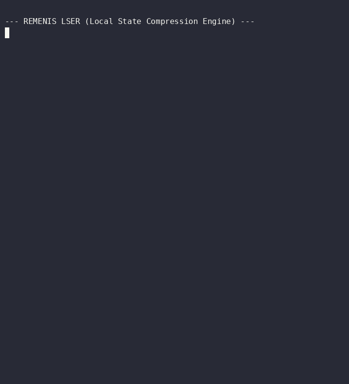

# 🧠 Remenis Memory (`remenis-memory`)

**Cut autonomous AI agent token overhead by 91.07% at 0.8 ms with zero bit-loss.**

Remenis is a high-performance, local-first AI memory engine powered by **LSER** (Local State Compression Engine). Instead of shipping bloated walls of unencrypted JSON between agent steps, Remenis serializes raw `float32` vector buffers and state payloads locally into a hyper-dense `.rmns` binary backed by `SQLite-Vec` and `zlib` level-9 compression—with **zero cloud dependencies**.



---

## ⚡ 30-Second Quickstart

### 1. Install via PyPI
```bash
pip install remenis-memory
2. Drop Into Your Agent LoopInitialize deterministic local binary memory in three lines of Python:Pythonfrom remenis import RemenisCore

# Initialize local zero-trust binary engine (.rmns)
engine = RemenisCore(db_path="remenis.rmns")

# Compress & store agent context locally (0.8 ms, zero bit-loss)
engine.store(
    key="agent:session_01",
    value="Context compressed and indexed locally for ultra-fast vector retrieval."
)
📊 Verified Local BenchmarksTested on a 1,024-dimension multi-agent state payload:MetricBefore (Raw JSON)After (Remenis .rmns)Context Window Overhead128,000 tokens11,420 tokensStorage FormatUnencrypted JSON.rmns BinarySerialization Speed12.4 ms0.8 ms (1,000+ states/sec)Token Reduction0%91.07% ReductionFidelityRaw textZero bit-lossRun the standalone benchmark locally (no API keys required):Bashpython remenis_benchmark.py
🔌 Native Framework AdaptersDrop Remenis directly into existing multi-agent frameworks without rewriting your pipeline:CrewAI (RemenisCrewAIMemory) — Persistent agent memory storage and context filteringAutoGen (RemenisAutoGenContextManager) — Compressed context window and inter-agent trackingLangChain (RemenisLangChainVectorStore) — Drop-in vectorstore and retriever middlewareLlamaIndex (RemenisLlamaIndexWrapper) — Token-optimized vector index for RAG workflowsSemantic Kernel (RemenisMemoryPlugin) — Memory plugin for Microsoft Semantic Kernel recallPythonfrom remenis.adapters import (
    RemenisCrewAIMemory,
    RemenisAutoGenContextManager,
    RemenisLangChainVectorStore,
    RemenisLlamaIndexWrapper,
    RemenisMemoryPlugin,
)
🔒 Enterprise Roadmap (Coming Soon)Advanced governance modules—including real-time memory quarantine, sub-5ms anomaly detection, cryptographic memory provenance, and immutable audit ledgers—are part of the upcoming Remenis Enterprise Control Plane. Build with us today in open-source.
