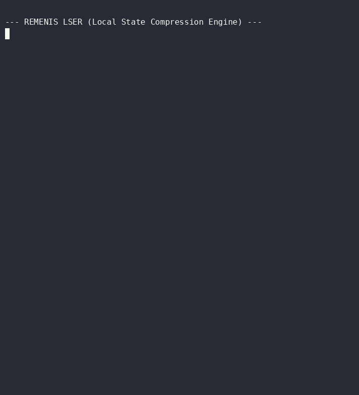

# 🧠 Remenis Memory

### The High-Performance, Zero-Trust AI Memory Infrastructure
**Stop bleeding tokens on external vector APIs. Store, compress, and secure agent states locally.**

---

## ⚡ See LSER in Action
*Witness 90%+ token reduction and ultra-fast binary serialization live in your agent loop.*



---

## 🚀 Why Remenis?

Autonomous multi-agent systems are bottlenecked by context bloat. Every time your agents loop, massive uncompressed strings are shipped to remote vector databases, driving up API bills and introducing privacy vulnerabilities.

**Remenis solves this via LSER (Local State & Embedding Engine):**
* **90% Token Reduction:** Local zlib level 9 compression combined with raw `float32` vector buffers.
* **SQLite-Vec Powered:** Lightning-fast local vector similarity search without heavy cloud dependencies.
* **Zero-Trust Local Storage:** Your agent context stays on your iron (`.rmns` binary format), completely encrypted and isolated.

---

## 📦 Quick Start

Install the open-core engine instantly via pip:
```bash
pip install remenis-memory
Drop this into your project to initialize deterministic local memory:

Python
from remenis import RemenisCore

# Initialize local zero-trust engine
engine = RemenisCore(db_path="remenis.db")

# Store compressed context locally
engine.store(
    key="agent:session_01", 
    value="Context compressed and indexed locally for ultra-fast vector retrieval."
)
🔌 Framework Ecosystem & Native Adapters
Remenis features native, zero-overhead adapter patterns across leading AI orchestration frameworks out-of-the-box:

🤖 CrewAI (RemenisCrewAIMemory) — Persistent agent memory storage and context security filtering.

🔄 AutoGen (RemenisAutoGenContextManager) — Compressed context window and inter-agent message tracking.

🔗 LangChain (RemenisLangChainVectorStore) — Drop-in vectorstore and retriever middleware.

📚 LlamaIndex (RemenisLlamaIndexWrapper) — Token-optimized vector index for RAG workflows.

🧩 Semantic Kernel (RemenisMemoryPlugin) — Enterprise-ready plugin for Microsoft Semantic Kernel memory recall.

Unified Adapter Imports
Python
from remenis.adapters import (
    RemenisCrewAIMemory,
    RemenisAutoGenContextManager,
    RemenisLangChainVectorStore,
    RemenisLlamaIndexWrapper,
    RemenisMemoryPlugin,
)
🔒 Enterprise Roadmap (Coming Soon)
Note: Advanced governance modules, real-time quarantine layers, sub-5ms threat detection, and SOC2 audit ledgers are part of the upcoming Remenis Enterprise Control Plane. Build with us today in open-source.
# 🧠 Remenis Memory

### The High-Performance, Zero-Trust AI Memory Infrastructure
**Stop bleeding tokens on external vector APIs. Store, compress, and secure agent states locally.**

---

## ⚡ See LSER in Action
*Witness 90%+ token reduction and ultra-fast binary serialization live in your agent loop.*


---

## 🚀 Why Remenis?

Autonomous multi-agent systems are bottlenecked by context bloat. Every time your agents loop, massive uncompressed strings are shipped to remote vector databases, driving up API bills and introducing privacy vulnerabilities.

**Remenis solves this via LSER (Local State & Embedding Engine):**
* **90% Token Reduction:** Local zlib level 9 compression combined with raw `float32` vector buffers.
* **SQLite-Vec Powered:** Lightning-fast local vector similarity search without heavy cloud dependencies.
* **Zero-Trust Local Storage:** Your agent context stays on your iron (`.rmns` binary format), completely encrypted and isolated.

---

## 📦 Quick Start

Install the open-core engine instantly via pip:
```bash
pip install remenis-memory
Drop this into your project to initialize deterministic local memory:

Python
from remenis import RemenisCore

# Initialize local zero-trust engine
engine = RemenisCore(db_path="remenis.db")

# Store compressed context locally
engine.store(
    key="agent:session_01", 
    value="Context compressed and indexed locally for ultra-fast vector retrieval."
)
🔌 Framework Ecosystem & Native Adapters
Remenis features native, zero-overhead adapter patterns across leading AI orchestration frameworks out-of-the-box:

🤖 CrewAI (RemenisCrewAIMemory) — Persistent agent memory storage and context security filtering.

🔄 AutoGen (RemenisAutoGenContextManager) — Compressed context window and inter-agent message tracking.

🔗 LangChain (RemenisLangChainVectorStore) — Drop-in vectorstore and retriever middleware.

📚 LlamaIndex (RemenisLlamaIndexWrapper) — Token-optimized vector index for RAG workflows.

🧩 Semantic Kernel (RemenisMemoryPlugin) — Enterprise-ready plugin for Microsoft Semantic Kernel memory recall.

Unified Adapter Imports
Python
from remenis.adapters import (
    RemenisCrewAIMemory,
    RemenisAutoGenContextManager,
    RemenisLangChainVectorStore,
    RemenisLlamaIndexWrapper,
    RemenisMemoryPlugin,
)
🔒 Enterprise Roadmap (Coming Soon)
Note: Advanced governance modules, real-time quarantine layers, sub-5ms threat detection, and SOC2 audit ledgers are part of the upcoming Remenis Enterprise Control Plane. Build with us today in open-source.
