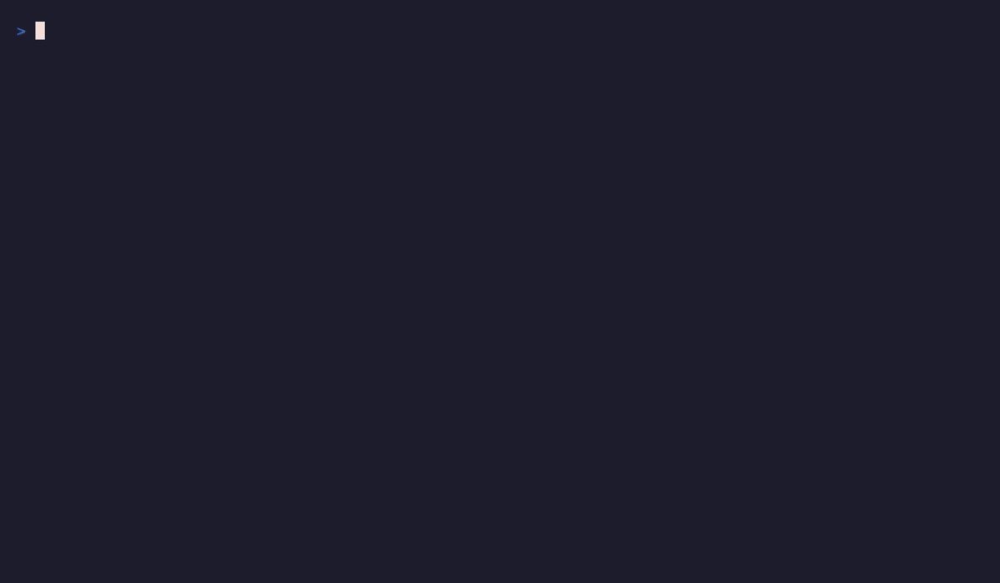

# Remenis Memory

**The High-Performance, Zero-Trust AI Memory Infrastructure**

Remenis is an open-core context engine engineered for autonomous agent systems. Powered by SQLite-Vec, local compression algorithms, and zero-latency guardrails, Remenis allows developers to store, search, and compress agent state locally without sending unencrypted context to external vector APIs.

---

## ⚡ Quick Start

Install the open-core engine via pip:

```bash
pip install remenis-memory
```

Initialize the deterministic memory engine in your application:

```python
from remenis import RemenisCore

# Initialize local zero-trust engine
engine = RemenisCore(db_path="remenis.db")

# Store compressed context locally
engine.store(
    key="agent:session_01", 
    value="Context compressed and indexed locally for ultra-fast vector retrieval."
)
```

---

## 🔌 Framework Ecosystem & Native Adapters

Remenis features native, zero-overhead adapter patterns across leading AI orchestration frameworks:

- **CrewAI (`RemenisCrewAIMemory`)** — Persistent agent memory storage and context security filtering.
- **AutoGen (`RemenisAutoGenContextManager`)** — Compressed context window and inter-agent message tracking.
- **LangChain (`RemenisLangChainVectorStore`)** — Drop-in vectorstore and retriever middleware.
- **LlamaIndex (`RemenisLlamaIndexWrapper`)** — Token-optimized vector index for RAG workflows.
- **Semantic Kernel (`RemenisMemoryPlugin`)** — Enterprise-ready plugin for Microsoft Semantic Kernel memory recall.

```python
# Unified Adapter Imports
from remenis.adapters import (
    RemenisCrewAIMemory,
    RemenisAutoGenContextManager,
    RemenisLangChainVectorStore,
    RemenisLlamaIndexWrapper,
    RemenisMemoryPlugin,
)
```

---

## 🛡️ Architecture & Enterprise Previews

> **Note:** The advanced governance modules, real-time quarantine layer, sub-5ms threat detection, and SOC2 audit ledgers highlighted below are part of the **Remenis Enterprise** closed-source SaaS control plane (coming soon).

### Security & Governance Layer


### Threat Quarantine Protocol


### Core Architecture & Memory Pillars


---

## 📄 License

Distributed under the MIT License. See `LICENSE` for details.
